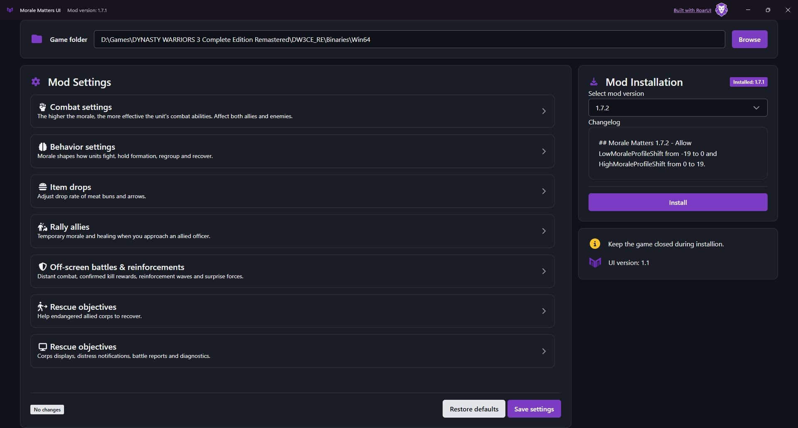
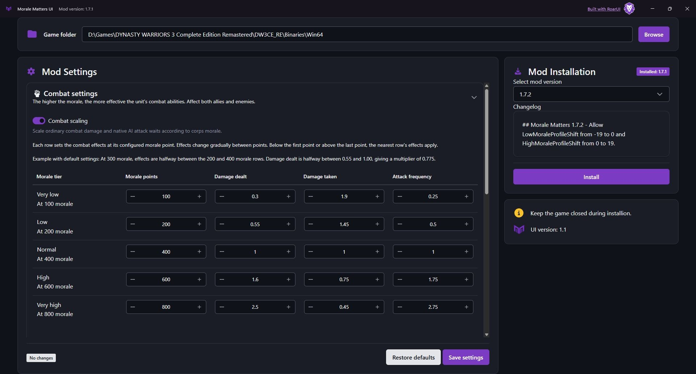

# Morale Matters

Morale Matters is a mod that makes morale matter more in **DYNASTY WARRIORS 3 Complete Edition Remastered**. It lets you define morale thresholds and control how morale affects damage dealt, damage taken and how often soldiers attempt to attack.

Higher morale can make troops stronger, more aggressive and hold tighter formations. Lower morale can make them less effective and trigger regrouping. The mod also adds ways to support allied officers, morale rewards for reinforcements and off-screen victories, and displays that help you follow the condition of each corps.

You can configure these features through **Morale Matters UI**, including their strength, thresholds, durations, cooldowns and display settings, or disable individual features.

## Features

- **Combat scaling:** Set damage dealt, damage taken and AI attack frequency at five morale levels. Effects change gradually between those levels and apply to both armies. Named-officer effect strength is adjustable; player characters do not receive their own morale multipliers.
- **Morale-driven behavior:** Morale affects aggression, guarding and evasion where a unit's abilities support them. Confident infantry hold tighter formations. Low-morale infantry can fall back, reform and rejoin while keeping their group's strategic orders.
- **Casualty penalties and panic:** Soldiers, elite troops, captains and subordinate officers have separate morale-loss values. A subordinate leader's defeat can also cause panic among nearby surviving groups, with a cap on the additional morale loss.
- **Commander leadership and recovery:** A nearby living commander reduces panic and helps stabilize formations. Corps can recover morale while out of combat, with faster recovery when their troops are close to the commander.
- **Rallying and healing allies:** Approaching an allied officer can give their corps temporary morale and restore the officer's health. Separate limits on morale bonuses and healing prevent repeated support from stacking continuously.
- **Enemy corps support:** Nearby leaders of different enemy corps give their corps temporary morale. The bonus ends when they separate or a supporting leader is defeated, unless another qualifying leader remains nearby.
- **Off-screen battles:** Named officers take a share of their group's damage while soldiers remain. Confirmed off-screen kills can grant permanent morale to the attacking corps. Existing game rewards count toward the reward, and additional mod gains have a per-corps cap.
- **Reinforcements and surprise forces:** Reinforcements joining an existing corps grant morale based on the increase in soldiers. Arriving surprise forces raise their corps to maximum base morale. Existing game morale rewards are accounted for to avoid duplicate rewards.
- **Item drops:** Adjust the combo hits required for random drops from enemy infantry and captains, and choose the chance of a meat bun versus arrows. Fixed item drops keep their existing rules.
- **Corps displays:** See commanders and total morale, with each surviving named subordinate officer (including Vice General) shown by portrait, name and health bar. Other surviving group leaders share one portrait and count. Portraits retain the configured sizes. Trend indicators show whether morale is rising or falling, and detail rows show recent causes, remaining support time and regroup phases. Temporary morale appears in yellow.
- **Distress alerts and rescue objectives:** Alerts identify wounded allied officers whose corps have low morale and recent losses. Rally or heal the officer, help defeat nearby enemies and stabilize the corps to complete a rescue and earn permanent morale.
- **Battle reports:** Review rescued corps, successful rallies, healing, nearby enemy formations broken and the largest morale recovery of a corps you supported. Reports can appear on the results screen and be saved to a text file. Nearby formation breaks are observations, not personal kill credit.

## Get started

Download `MoraleMattersUI-ui-win-x64-Setup.exe` from the newest **Morale Matters UI** release on the [Releases page](https://github.com/Blazor-School/DW3R-MoraleMatters/releases), install it, then open **Morale Matters UI**.

You need the Windows x64 game with an ASI loader and UE4SS already installed. The UI installs Morale Matters; it does not install either loader. Internet access is needed to retrieve available mod versions and download releases.

### 1. Select the game folder

Use **Browse** beside **Game folder** and select:

```text
<game installation>\DW3CE_RE\Binaries\Win64
```

This folder must contain both `DW3CE_RE-Win64-Shipping.exe` and `DW3CE_RE-Win64-Shipping.tnk`. The UI remembers your selection and loads the settings of a recognized installed mod.

### 2. Install or update the mod

Close the game. In **Mod Installation**, choose a version under **Select mod version**, read its **Changelog**, then select **Install**. The newest available version is selected initially.

The **Installed: …** badge shows the detected local mod version. When it matches the selected version, the button reads **Installed**. **Mod Settings** becomes available once a recognized mod is installed.

**Installing a version replaces the mod files, including `MoraleMatters.ini`, with that release's defaults.** Back up this file from the selected game folder if you want to keep your configuration, then review your settings after installation.



*Example: mod 1.7.1 is installed and 1.7.2 is selected. UI and mod versions are separate.*

### 3. Configure and save

Expand a section in **Mod Settings** and adjust the options you want. Each section includes descriptions and field hints.

| Section | What you can change |
| --- | --- |
| **Combat settings** | Damage dealt, damage taken and AI attack frequency at five morale levels; named-officer effect strength; morale penalties for casualties. |
| **Behavior settings** | AI decisions, formation spacing, infantry regrouping, panic after nearby defeats, passive recovery, commander leadership and support between nearby enemy corps. |
| **Item drops** | Required combo hits and the chance of meat buns versus arrows. |
| **Rally allies** | Approach distance, temporary morale, healing, cooldowns and support popup text. |
| **Off-screen battles & reinforcements** | Officer damage sharing, morale rewards for distant kills, reinforcement rewards and maximum morale for arriving surprise forces. |
| **Rescue objectives** | Rescue time limits, recovery targets, nearby enemy casualties and morale rewards. |
| **Display and report options** | Corps panels, portraits, position, colors, morale details, distress alerts, battle reports and performance diagnostics. |

The last section currently also has the heading **Rescue objectives**. Identify it by the description **“Corps displays, distress notifications, battle reports and diagnostics.”**

Edits are not saved automatically. Select **Save settings** when finished. Correct any validation messages if saving is rejected. A success notification confirms that the settings were written; **restart the game for them to take effect**. The UI can be closed while you play.



#### Reading the values

- **Morale points** use the game's 1–899 scale; fields marked **percent** use percentages. A bonus of 100 points is about 11 percentage points on the HUD.
- **Damage dealt / Damage taken** are multipliers: `1` is normal, `2` doubles the coefficient and `0.5` halves it. Combat effects apply to both armies; player characters do not receive their own morale multipliers.
- **Attack frequency** changes native AI attack retry waits. Higher values shorten those waits; attack animations keep their normal speed.
- Combat effects change gradually between the five rows. Keep morale points increasing from **Very low** to **Very high**.
- Fraction fields use `0`–`1`: for example, a **Healing fraction** of `0.5` restores 50% of maximum health. Gameplay durations and cooldowns use battle time.

#### Restore defaults

**Restore defaults** resets the entire settings form to the UI's defaults. Select **Save settings** to write those defaults to the game folder, then restart the game. It does not undo an installation or restore your previous custom configuration.

## Troubleshooting

| Problem | Check |
| --- | --- |
| **Game not found** | Select the `Win64` folder containing both the `.exe` and `.tnk` files listed above. |
| **Not installed**, or settings are unavailable | Check the selected folder. Detection recognizes known released ASI files; a custom or unrecognized build can also appear as not installed. |
| No versions appear, or installation fails | Check access to GitHub, write access to the selected folder, and that the game is closed. |
| **Settings contain invalid values** | Check the expanded sections for validation messages. Rearm distance must be at least the encounter radius; regroup recovery must be at least its start threshold; combat morale points must increase across the rows. |
| Saved settings have no effect | Restart the game and confirm the UI points to the installation you are launching. |
| The mod does not load or behaves unexpectedly | Check the ASI loader and UE4SS, then inspect `MoraleMatters.log` in the selected folder and `ue4ss/UE4SS.log`. Mods changing the same combat, morale, AI or HUD behavior may conflict. |

The native mod supports a specific game executable and refuses other builds. Its supported executable SHA-256 is:

```text
b57a2d4cbd01c9c5abd651fa42f43a4b8fdae88da6403106cd5f5c1bf4dade70
```
