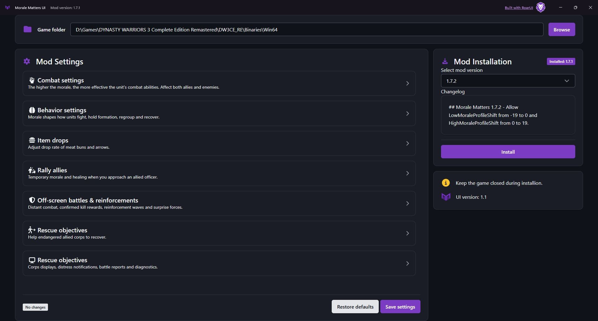
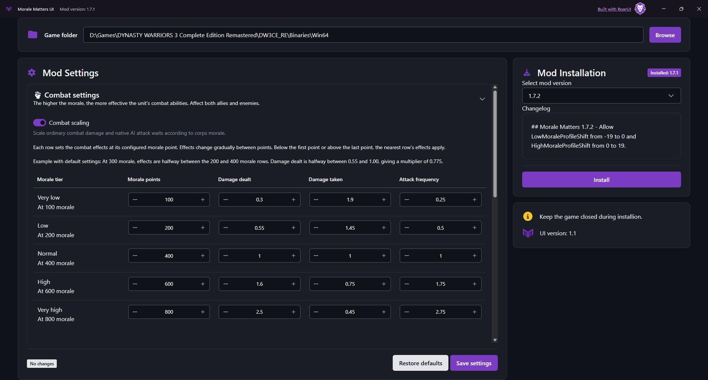

# Morale Matters

Morale Matters is a mod that makes morale matter more in **DYNASTY WARRIORS 3 Complete Edition Remastered**. It lets you define morale thresholds and control how morale affects damage dealt, damage taken and how often soldiers attempt to attack.

Higher morale can make troops stronger, more aggressive and hold tighter formations. Lower morale can make them less effective and trigger regrouping. The mod also adds ways to support allied officers, morale rewards for reinforcements and off-screen victories, and displays that help you follow the condition of each corps.

You can configure these features through **Morale Matters UI**, including their strength, thresholds, durations, cooldowns and display settings, or disable individual features.

## Features

- **Guard feedback (1.9.0):** Up to three recently pressured enemies show a larger row of gold fortitude shields inspired by the supplied Origins clip. Shields drain as pressure builds, pulse on blocked hits, and split apart with a larger **GUARD BROKEN** message. They refill to full as soon as the opening ends and briefly show the full row. Ordinary/elite/officer defaults display 3/5/6 shields; the icons represent remaining guard strength rather than a count of hits. The shields attach directly to each enemy's native floating HP gauge, above the HP strip and below the raised name, and inherit its camera movement, scaling and visibility. They hide when the native gauge is unavailable, after recovery feedback ends, and on results screens. Blocked hits and full breaks play distinct short samples from the reference clip, deduplicated and rate-limited across simultaneous events. Full breaks take priority over hit cues. Under **Behavior settings → Guard pressure**, independently toggle shields, break indicators and sound, or adjust indicator duration (default `1.2` seconds). Feedback remains available with the corps HUD disabled.
- **Guard pressure and breakthroughs (1.9.0):** Blocked player melee hits build pressure on each enemy. Normal hits and Musou hits add `1` by default, and hits with the game’s charge flag add `3`. Default break thresholds are `6` for ordinary troops, `9` for classified elites and `12` for named officers. Breaking a guard uses the native recoil/effect and creates a `0.9`-second opening against subsequent player melee hits. Partial pressure recovers after `2` seconds without blocking; high morale improves recovery without increasing thresholds. A break can make up to `6` nearby ordinary melee troops within `4` metres hesitate: `0.8` seconds at reference morale, longer at low morale and shorter at high morale. Active attacks, named officers, allies and scripted orders are excluded from hesitation. Separate break and disruption cooldowns limit repeated triggering. Native charge-interrupt counterattacks retain their rules. Configure **Guard pressure** under **Behavior settings**, or `[GuardPressure]` in the INI; the feature works independently of behavior and damage scaling.
- **Combat scaling:** Set damage dealt, damage taken and AI attack frequency at five morale levels. Effects change gradually between those levels and apply to both armies. Named-officer effect strength is adjustable; player characters do not receive their own morale multipliers.
- **Weapon fusion.** Matching numeric tiles take the donor value when it is higher. A lower or equal donor increases the destination by `2` by default, configurable under **Weapon fusion** or `[WeaponFusion] Increment`. Values saturate at the signed 32-bit storage limit. Other officer skills retain native rules.
- **Bodyguard Weapon Fusion (1.9.0).** Select **Weapon Fusion** under **Bodyguard** in Equipment before starting a stage. In Camp, open **Musou Officers** and choose an officer to reach the same Equipment menu. Choose a weapon to keep and an unequipped donor from the same weapon family. Matching bodyguard skills use the same higher-value and lower-or-equal increment rules as officer weapons. Confirm to consume the donor. In Camp, save when leaving. Turning off `[WeaponFusion] Enabled` hides the Bodyguard entry and restores the native officer fusion rules.
- **HUD stability (1.9.0):** Shield feedback, morale panels and delayed support text use retained game-thread timers instead of async Lua polling. F7/F8 and configured HUD keys are sampled on the game thread while the game has focus. This requires a UE4SS build with `LoopInGameThreadWithDelay` and `ExecuteInGameThreadWithDelay` (available in the tested `e3ba1016` build). If unavailable, Lua HUD controls stop with a log message; native combat remains active.
- **Archers (1.8.0):** Ordinary bow-archer troops on both sides can choose a random eligible enemy when acquiring a target, with no player priority. Valid targets are retained. Separately adjust their on-screen damage taken (`0` = no incoming hit damage, `1` = normal, `1.5` = 50% more, range `0`–`10`). Named officers and crossbowmen are excluded; scripted orders remain native. Both options work independently of morale combat scaling.
- **Morale-driven behavior:** Morale affects aggression, guarding and evasion where a unit's abilities support them. Confident infantry hold tighter formations. Low-morale infantry can fall back, reform and rejoin while keeping their group's strategic orders.
- **Corps break and rally (1.9.0):** At or below the Very Low combat morale anchor, ordinary troops in the broken corps stop requesting attack tickets. Some soldiers slump and stay seated. Others turn and sprint away unarmed, then crouch with their arms raised once they are about 28 metres from the player or their escape route is blocked. After three continuous battle seconds above Very Low, the soldiers stand, regain their weapons and resume fighting in waves. Named officers, including Vice Generals, and corps commanders keep their normal combat behavior. The corps HUD shows **Line broken** and **Rallying**. Turn off **Corps break and rally** under **Behavior settings** to use the timed morale regrouping rules.
- **Casualty penalties and panic:** Soldiers, elite troops, captains and subordinate officers have separate morale-loss values. A subordinate leader's defeat can also cause panic among nearby surviving groups, with a cap on the additional morale loss.
- **Commander leadership and recovery:** A nearby living commander reduces panic and helps stabilize formations. Corps can recover morale while out of combat, with faster recovery when their troops are close to the commander.
- **Rallying and healing allies:** Approaching an allied officer can give their corps temporary morale and restore the officer's health. Separate limits on morale bonuses and healing prevent repeated support from stacking continuously.
- **Enemy corps support:** Nearby leaders of different enemy corps give their corps temporary morale. The bonus ends when they separate or a supporting leader is defeated, unless another qualifying leader remains nearby.
- **Off-screen battles:** Named officers take a share of their group's damage while soldiers remain. Confirmed off-screen kills can grant permanent morale to the attacking corps. Existing game rewards count toward the reward, and additional mod gains have a per-corps cap.
- **Reinforcements and surprise forces:** Reinforcements joining an existing corps grant morale based on the increase in soldiers. Arriving surprise forces raise their corps to maximum base morale. Existing game morale rewards are accounted for to avoid duplicate rewards.
- **Item drops:** Adjust the combo hits required for random drops from enemy infantry and captains, and choose the chance of a meat bun versus arrows. Fixed item drops keep their existing rules.
- **Corps displays:** See commanders and total morale, with each surviving named subordinate officer (including Vice General) shown by portrait, name and health bar. Other surviving group leaders share one portrait and count. Portraits retain the configured sizes. Trend indicators show whether morale is rising or falling, and detail rows show recent causes, remaining support time and regroup phases. Temporary morale appears in yellow.
- **Distress alerts and rescue objectives:** Alerts identify wounded allied officers whose corps have low morale and recent losses. Rally or heal the officer, help defeat nearby enemies and stabilize the corps to complete a rescue and earn permanent morale.
- **Battle reports:** Review rescued corps, successful rallies, healing, nearby enemy formations broken and the largest morale recovery of a corps you supported. Reports can appear on the results screen and be saved to a text file. Nearby formation breaks are observations, not personal kill credit.

## Get started

Download `MoraleMattersUI-ui-win-x64-Setup.exe` from the newest **Morale Matters UI** release on the [Releases page](https://github.com/Blazor-School/DW3R-MoraleMatters/releases), install it, then open **Morale Matters UI**.

You need the Windows x64 game with an ASI loader and UE4SS already installed. The UI installs Morale Matters; it does not install either loader. Internet access is needed to retrieve available mod versions and download releases.

### 1. Select the game folder

Use **Browse** beside **Game folder** and select:

```text
<game installation>\DW3CE_RE\Binaries\Win64
```

This folder must contain `DW3CE_RE-Win64-Shipping.exe` or `DW3CE_RE-Win64-Shipping.tnk.exe`. The UI remembers your selection and loads the settings of a recognized installed mod.

### 2. Install or update the mod

Close the game. In **Mod Installation**, choose a version under **Select mod version**, read its **Changelog**, then select **Install**. The newest available version is selected initially.

The **Installed: …** badge shows the detected local mod version. When it matches the selected version, the button reads **Installed**. **Mod Settings** becomes available once a recognized mod is installed.

**Installing a version replaces the mod files, including `MoraleMatters.ini`, with that release's defaults.** Back up this file from the selected game folder if you want to keep your configuration, then review your settings after installation.



*Example: mod 1.7.1 is installed and 1.7.2 is selected. UI and mod versions are separate.*

### 3. Configure and save

Expand a section in **Mod Settings** and adjust the options you want. Each section includes descriptions and field hints.

| Section | What you can change |
| --- | --- |
| **Combat settings** | Damage dealt, damage taken and AI attack frequency at five morale levels; named-officer effect strength; archer random targeting and damage taken; morale penalties for casualties. |
| **Behavior settings** | AI decisions, formation spacing, infantry regrouping, panic after nearby defeats, passive recovery, commander leadership, guard pressure and local disruption, and support between nearby enemy corps. |
| **Item drops** | Required combo hits and the chance of meat buns versus arrows. |
| **Rally allies** | Approach distance, temporary morale, healing, cooldowns and support popup text. |
| **Off-screen battles & reinforcements** | Officer damage sharing, morale rewards for distant kills, reinforcement rewards and maximum morale for arriving surprise forces. |
| **Rescue objectives** | Rescue time limits, recovery targets, nearby enemy casualties and morale rewards. |
| **Display and report options** | Corps panels, portraits, position, colors, morale details, distress alerts, battle reports and performance diagnostics. |

The last section currently also has the heading **Rescue objectives**. Identify it by the description **“Corps displays, distress notifications, battle reports and diagnostics.”**

Edits are not saved automatically. Select **Save settings** when finished. Correct any validation messages if saving is rejected. A success notification confirms that the settings were written; **restart the game for them to take effect**. The UI can be closed while you play.



#### Reading the values

- **Morale points** use the game's 1–899 scale; fields marked **percent** use percentages. A bonus of 100 points is about 11 percentage points on the HUD.
- **Damage dealt / Damage taken** are multipliers: `1` is normal, `2` doubles the coefficient and `0.5` halves it. Combat effects apply to both armies; player characters do not receive their own morale multipliers.
- **Archer settings** default to random targeting and `1.5` damage taken. Turn random targeting off to restore native selection, or set archer damage taken to `1` to disable the extra damage. Set `DamageTakenMultiplier=0` in `MoraleMatters.ini` for no incoming on-screen hit damage. Values below `1` are INI-only; the UI retains its existing input limits.
- **Attack frequency** changes native AI attack retry waits. Higher values shorten those waits; attack animations keep their normal speed.
- **Guard pressure** counts blocked hits, including individual hits of multi-hit charge and Musou attacks. Three blocked normal hits followed by one blocked charge hit reach an ordinary soldier's default threshold of `6`. The opening starts with the break; pressure breaks have a further `3`-second cooldown after that opening. Native guaranteed breaks still work during cooldown. Local disruption has a per-source-group cooldown and a per-target cooldown; it adds no morale loss or damage and cannot trigger further disruption pulses. Mounted attacks, projectiles, throws, fixed damage, unblockables and script-protected enemies keep native handling.
- **Guard shields** drain toward a break. Fewer gold shields means the enemy is closer to losing its guard. The break label is an event indicator and its duration can differ from the combat opening. `[GuardPressure] ShowPressureBar` controls the shield rows, and `BreakSound` controls both custom cues. Each cue uses the game's **Sound Effects** slider multiplied by its own INI cap, `HitVolumePercent` or `BreakVolumePercent`. Both caps default to `50` and accept `0` to `100`. A cap of `50` with the slider at `80%` plays at `40%` of the clip's original amplitude. Hit cues never interrupt full breaks. See `Scripts/Assets/README.txt` for source and timing.
- Combat effects change gradually between the five rows. Keep morale points increasing from **Very low** to **Very high**.
- Fraction fields use `0`–`1`: for example, a **Healing fraction** of `0.5` restores 50% of maximum health. Gameplay durations and cooldowns use battle time.

#### Restore defaults

**Restore defaults** resets the entire settings form to the UI's defaults. Select **Save settings** to write those defaults to the game folder, then restart the game. It does not undo an installation or restore your previous custom configuration.

## Troubleshooting

| Problem | Check |
| --- | --- |
| **Game not found** | Select the `Win64` folder containing either executable listed above. |
| **Not installed**, or settings are unavailable | Check the selected folder. Detection recognizes known released ASI files; a custom or unrecognized build can also appear as not installed. |
| No versions appear, or installation fails | Check access to GitHub, write access to the selected folder, and that the game is closed. |
| **Settings contain invalid values** | Check the expanded sections for validation messages. Rearm distance must be at least the encounter radius; regroup recovery must be at least its start threshold; combat morale points must increase across the rows. |
| Saved settings have no effect | Restart the game and confirm the UI points to the installation you are launching. |
| The mod does not load or behaves unexpectedly | Check the ASI loader and UE4SS, then inspect `MoraleMatters.log` in the selected folder and `ue4ss/UE4SS.log`. Mods changing the same combat, morale, AI or HUD behavior may conflict. |

The native mod accepts the executable names `DW3CE_RE-Win64-Shipping.exe` and `DW3CE_RE-Win64-Shipping.tnk.exe`. Before installing hooks, it checks the executable hash, the corresponding image size, and the code bytes at the expected locations.

| Executable SHA-256 | Expected image size |
| --- | --- |
| `b57a2d4cbd01c9c5abd651fa42f43a4b8fdae88da6403106cd5f5c1bf4dade70` | `0xB39E000` |
| `ca1a65a53242a7cf42493bd2006b8c555d87597387468e4b7a07c52d4eefe92e` | `0xB3D8000` |
| `8a3644a0e002ece5867c2f49720a4ed05900af7e09d10d39f8404b6086382849` (game patch 1.1.0) | `0xB3C9000` |
| `b6c1023db00b858927d4eeb2a71f8bfc42a3f55ef3ab2aebf3c5f4ec75e390bc` (`.tnk.exe`, game patch 1.1.0 layout) | `0xB403000` |
